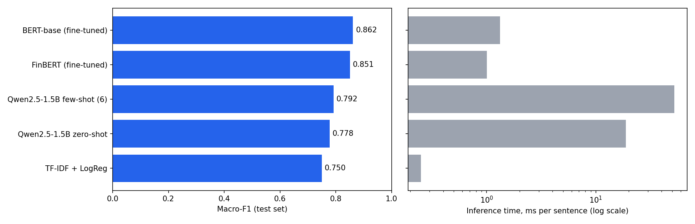
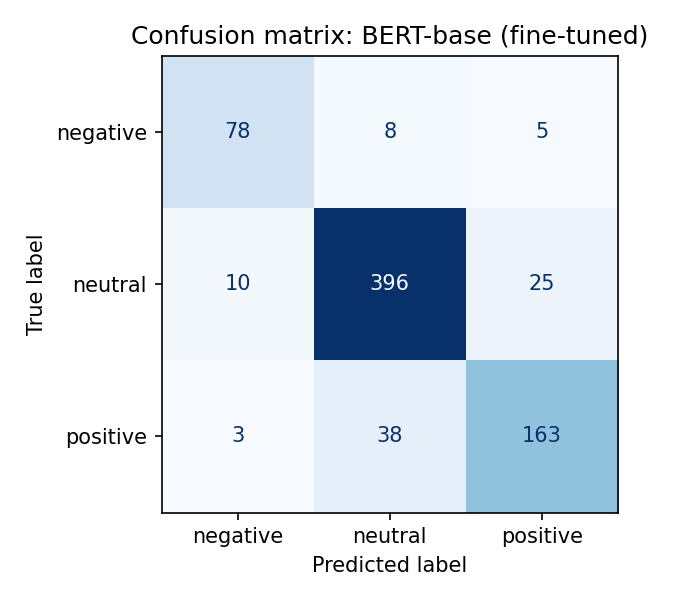

# Financial Sentiment Analysis: Fine-Tuned FinBERT vs LLMs

**For classifying financial news sentiment, does a small transformer fine-tuned on labelled data beat a general-purpose LLM prompted zero- or few-shot? And at what cost?**

Five approaches are benchmarked on **Financial PhraseBank** (4,838 financial news sentences labelled positive / negative / neutral by finance-literate annotators), all evaluated on the same held-out test set of 726 sentences.

## Results

| Model | Approach | Macro-F1 (test) |
|-------|----------|---------:|
| **BERT-base** | General-domain transformer, fine-tuned | **0.862** |
| **FinBERT** (`yiyanghkust/finbert-pretrain`) | Finance-domain transformer, fine-tuned | **0.851** |
| Qwen2.5-1.5B-Instruct, few-shot (6 examples) | Open-source LLM, prompting only | 0.792 |
| Qwen2.5-1.5B-Instruct, zero-shot | Open-source LLM, prompting only | 0.778 |
| TF-IDF + Logistic Regression | Classical baseline | 0.750 |

**Efficiency:** fine-tuned FinBERT is **19x faster** at inference than the LLM, with **14x fewer parameters** (about 110M vs about 1.5B).

## Key findings

1. **Fine-tuning beats prompting.** Both fine-tuned transformers beat the best LLM setup by **6–7 macro-F1 points** while being an order of magnitude cheaper to run.
2. **Few-shot examples help the LLM only a little** (+1.4 points over zero-shot), not enough to close the gap.
3. **Domain pre-training gave no gain here.** FinBERT scored slightly below general BERT (0.851 vs 0.862). With thousands of labelled examples, fine-tuning matters more than the pre-training corpus. A ~1-point gap from one run is also within run-to-run noise; multi-seed testing is a natural next step.
4. **All transformers clearly beat the bag-of-words baseline** (+10–11 points).

## Design decisions

- **No test-set leakage:** `ProsusAI/finbert` was already fine-tuned on Financial PhraseBank, so this project uses `yiyanghkust/finbert-pretrain`, which never saw sentiment labels. Duplicates are removed before splitting.
- **BERT-base as a control**, to isolate the value of financial pre-training.
- **Macro-F1** as the main metric, because about 60% of sentences are neutral.
- **Stratified 70/15/15 split**; the best epoch is chosen on validation and the test set is used once.
- **Fair LLM evaluation:** greedy decoding, few-shot examples from the training set only, and unparseable outputs counted.
- **Error analysis** by linguistic pattern (negation, hedging, numbers), plus an interactive **Gradio** demo.

## How to run

Open the notebook in Google Colab, set `Runtime → Change runtime type → T4 GPU`, then `Runtime → Run all` (about 15–20 min, free, no API keys).

## Tech stack

Python · PyTorch · Hugging Face Transformers · scikit-learn · Qwen2.5 · Gradio · Pandas · Matplotlib
